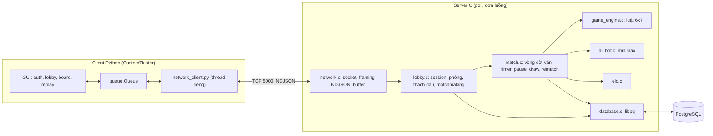
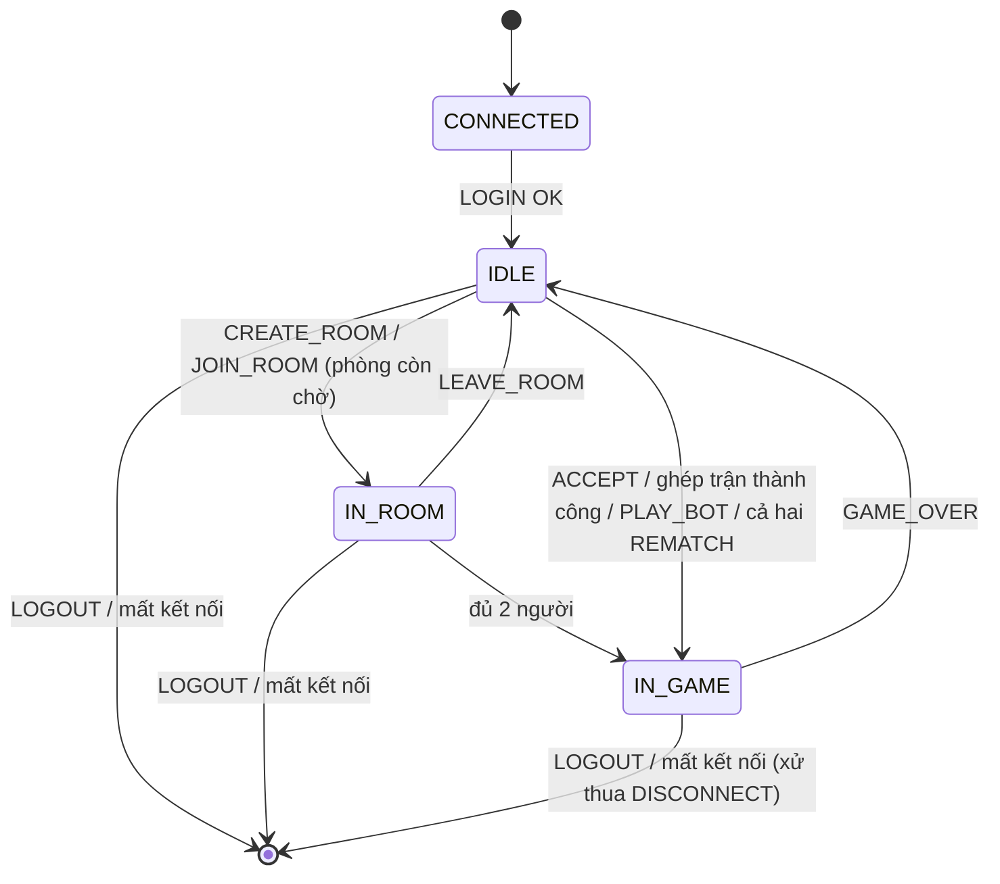

# Connect Four Online - Kế hoạch dự án hoàn chỉnh

**Nhóm 11:** Trần Trung Hiếu (20235934), Phạm Song Hào (20235930), Nguyễn Đức Hoàng (20235938)
**Đề tài:** Ứng dụng game online theo lượt - Connect Four (bàn cố định 6 hàng × 7 cột)
**Tài liệu liên quan:** [`protocol_ndjson.md`](protocol_ndjson.md) (đặc tả giao thức, bản chuẩn), [`protocol_ndjson_en.md`](protocol_ndjson_en.md) (bản tiếng Anh), [`server_c/protocol.h`](server_c/protocol.h) (hằng số và helper dùng chung), [`phan_chia_viec_va_cau_truc.md`](phan_chia_viec_va_cau_truc.md) (phân công chi tiết)

> **Thứ tự ưu tiên khi các tài liệu lệch nhau:** `protocol_ndjson.md` > `server_c/protocol.h` > `PLAN.md` > các tài liệu khác (slide, docx, hình). Sửa giao thức thì sửa `protocol_ndjson.md` trước, rồi đồng bộ sang bản tiếng Anh và `protocol.h`.

---

## 1. Các quyết định đã chốt

| Hạng mục | Quyết định |
|---|---|
| Server | C, socket TCP không chặn, I/O multiplexing bằng `poll()`, đơn luồng, cổng mặc định 5000 |
| Client | Python + CustomTkinter, thread mạng riêng, giao tiếp với UI qua `queue.Queue` + `after()` |
| Giao thức | NDJSON v2.0: mỗi message là 1 JSON object trên 1 dòng, tối đa 4096 byte, lệnh có `id`, phản hồi `OK`/`ERR`, sự kiện không có `id` |
| Cơ sở dữ liệu | PostgreSQL, truy cập bằng `libpq` (`PQexecParams`, không nối chuỗi SQL) |
| JSON trong C | cJSON |
| Bàn cờ | Cố định 6 × 7, `RED` đi trước, thắng khi có 4 quân liên tiếp |
| Mô hình ghép trận | Hỗ trợ cả 4: phòng (`CREATE_ROOM`/`JOIN_ROOM`), thách đấu (`CHALLENGE`/`ACCEPT`), ghép trận theo ELO (`FIND_MATCH`), đấu với Bot (`PLAY_BOT`) |
| Session | Gắn với kết nối TCP sau `LOGIN`. Không dùng token, không reconnect vào ván cũ |
| Mất kết nối | Đóng socket hoặc 45 giây không có dữ liệu: xử thua ngay (`DISCONNECT`). Client gửi `PING` mỗi 15 giây |
| Turn time | Mặc định 30 giây/nước, cho chọn khi `CREATE_ROOM`, `CHALLENGE`, `PLAY_BOT`. Hợp lệ: `0` (không giới hạn) hoặc 5 đến 120 giây |
| Pause | Cần đối thủ đồng ý, tối đa 60 giây, khi resume thì giữ nguyên số giây còn lại của lượt |
| Bot AI | 3 mức: `EASY` (ELO 800), `MEDIUM` (ELO 1200), `HARD` (ELO 1600) |
| ELO | K = 32, khởi đầu 1200. Đấu với Bot không bao giờ bị trừ ELO, ván vẫn được lưu lịch sử |

---

## 2. Kiến trúc tổng thể



### 2.1 Vòng lặp chính của server

```
khởi tạo: đọc db_config.env, kết nối PostgreSQL, mở socket lắng nghe
lặp vô hạn:
    poll(fds, timeout = 500 ms)
    với fd lắng nghe có POLLIN    -> accept, đặt non-blocking, thêm vào mảng fds
    với fd client có POLLIN       -> recv vào buffer, tách từng dòng '\n', parse JSON, dispatch lệnh
    với fd client có POLLOUT      -> gửi tiếp phần còn lại của buffer ghi
    với fd lỗi / recv trả 0       -> xử lý mất kết nối
    tick_timers(now):
        - ván đang chạy, không pause, turn_time > 0, now - turn_start_time > turn_time -> GAME_OVER TIMEOUT
        - ván đang pause, now - pause_start_time >= 60                               -> tự RESUME
        - lời thách đấu quá 30 giây                                                  -> CHALLENGE_EXPIRED
        - kết nối im lặng quá 45 giây                                                -> xử lý mất kết nối
        - hàng đợi FIND_MATCH                                                        -> thử ghép, nới khoảng ELO
```

> [!IMPORTANT]
> Vì server đơn luồng, nước đi của Bot phải tính xong trong khoảng **200 ms** để không làm đứng các client khác. Giới hạn độ sâu tìm kiếm thay vì giới hạn theo thời gian thực.

---

## 3. Cấu trúc thư mục

```
Connect-Four/
├── PLAN.md                     # Tài liệu này
├── README.md                   # Hướng dẫn cài đặt, build, chạy
├── protocol_ndjson.md          # Đặc tả giao thức (bản chuẩn)
├── protocol_ndjson_en.md       # Đặc tả giao thức (tiếng Anh)
├── phan_chia_viec_va_cau_truc.md
├── .gitignore                  # build/, *.o, server binary, db_config.env, __pycache__/
│
├── server_c/
│   ├── Makefile                # -lpq -lcrypt, cJSON
│   ├── protocol.h              # Hằng số, enum, struct, helper giao thức
│   ├── main.c                  # (A)
│   ├── network.[hc]            # (A) socket, poll, framing
│   ├── lobby.[hc]              # (A) session, phòng, thách đấu, matchmaking, PLAY_BOT
│   ├── game_engine.[hc]        # (B) luật 6x7
│   ├── match.[hc]              # (B) vòng đời ván
│   ├── elo.[hc]                # (B)
│   ├── ai_bot.[hc]             # (B)
│   ├── database.[hc]           # (B) libpq
│   ├── third_party/cJSON.[hc]
│   └── tests/                  # test engine, ELO, framing, bot
│
├── client_python/              # (C)
│   ├── requirements.txt        # customtkinter
│   ├── main.py
│   ├── network_client.py
│   ├── mock_server.py
│   ├── gui_auth.py
│   ├── gui_lobby.py
│   ├── gui_board.py
│   ├── gui_replay.py
│   └── assets/
│
└── database/
    ├── schema.sql              # Có commit
    └── db_config.env.example   # Có commit; bản thật db_config.env KHÔNG commit
```

---

## 4. Phân công

| Thành viên | Vai trò | File phụ trách |
|---|---|---|
| **A - Trần Trung Hiếu** (20235934) | Network, Lobby & Session | `main.c`, `network.[hc]`, `lobby.[hc]` |
| **B - Nguyễn Đức Hoàng** (20235938) | Game Engine, Match, ELO, Bot AI & Database | `game_engine.[hc]`, `match.[hc]`, `elo.[hc]`, `ai_bot.[hc]`, `database.[hc]`, `database/schema.sql` |
| **C - Phạm Song Hào** (20235930) | Client GUI & Replay | toàn bộ `client_python/` |
| **Cả nhóm** | Giao thức, README, báo cáo, slide, demo | `protocol_ndjson*.md`, `protocol.h` |

Nguyên tắc: mỗi file có đúng một owner, người khác muốn sửa thì báo owner hoặc mở pull request.

---

## 5. Thiết kế cơ sở dữ liệu (PostgreSQL)

```sql
CREATE TABLE IF NOT EXISTS users (
    id            SERIAL PRIMARY KEY,
    username      VARCHAR(16) NOT NULL UNIQUE,
    password_hash TEXT,                              -- NULL với tài khoản Bot
    elo           INTEGER NOT NULL DEFAULT 1200,
    wins          INTEGER NOT NULL DEFAULT 0,        -- Thành tích PvP (Đấu người)
    losses        INTEGER NOT NULL DEFAULT 0,
    draws         INTEGER NOT NULL DEFAULT 0,
    bot_wins      INTEGER NOT NULL DEFAULT 0,        -- Thành tích vs Bot (hiển thị ở tab vs Bot)
    bot_losses    INTEGER NOT NULL DEFAULT 0,
    bot_draws     INTEGER NOT NULL DEFAULT 0,
    is_bot        BOOLEAN NOT NULL DEFAULT FALSE,
    created_at    TIMESTAMPTZ NOT NULL DEFAULT now()
);

-- Bot là tài khoản hệ thống (không đăng nhập được, ELO cố định)
INSERT INTO users (username, password_hash, elo, is_bot) VALUES
    ('BOT_EASY',   NULL,  800, TRUE),
    ('BOT_MEDIUM', NULL, 1200, TRUE),
    ('BOT_HARD',   NULL, 1600, TRUE)
ON CONFLICT (username) DO NOTHING;

CREATE TABLE IF NOT EXISTS matches (
    id               SERIAL PRIMARY KEY,               -- chính là game_id trong giao thức
    red_id           INTEGER NOT NULL REFERENCES users(id),
    yellow_id        INTEGER NOT NULL REFERENCES users(id),
    turn_time        INTEGER NOT NULL,
    is_bot_match     BOOLEAN NOT NULL DEFAULT FALSE,
    winner           VARCHAR(6)  CHECK (winner IN ('RED', 'YELLOW', 'DRAW')),
    reason           VARCHAR(12) CHECK (reason IN ('CONNECT4', 'BOARD_FULL', 'RESIGN',
                                                   'DRAW_AGREED', 'DISCONNECT', 'TIMEOUT')),
    red_elo_delta    INTEGER,
    yellow_elo_delta INTEGER,
    started_at       TIMESTAMPTZ NOT NULL DEFAULT now(),
    ended_at         TIMESTAMPTZ                       -- NULL khi ván chưa kết thúc
);

CREATE TABLE IF NOT EXISTS match_moves (
    match_id INTEGER  NOT NULL REFERENCES matches(id) ON DELETE CASCADE,
    move_no  SMALLINT NOT NULL CHECK (move_no BETWEEN 1 AND 42),
    col      SMALLINT NOT NULL CHECK (col BETWEEN 0 AND 6),
    PRIMARY KEY (match_id, move_no)
);

CREATE INDEX IF NOT EXISTS idx_matches_red    ON matches (red_id, ended_at DESC);
CREATE INDEX IF NOT EXISTS idx_matches_yellow ON matches (yellow_id, ended_at DESC);
```

**Quy tắc ghi dữ liệu:**
- **Lúc `GAME_START`:** `INSERT INTO matches (...) RETURNING id`, lấy `id` làm `game_id` gửi cho client. Nhờ vậy `game_id` trong `GAME_START`, `GAME_OVER`, `HISTORY`, `GET_GAME` luôn trùng nhau.
- **Lúc `GAME_OVER`:** trong một transaction (`BEGIN ... COMMIT`): cập nhật `matches` (winner, reason, delta, ended_at), ghi toàn bộ `match_moves`, cập nhật `elo` và `wins/losses/draws` của người chơi. Bot không bị cập nhật ELO.
- **`HISTORY`** chỉ lấy các ván có `ended_at IS NOT NULL`. Ván bị bỏ dở do server sập vẫn có `ended_at = NULL` và bị bỏ qua.
- **Mật khẩu:** băm bằng `crypt()` kiểu SHA-512 (`$6$`) với salt ngẫu nhiên 16 ký tự lấy từ `/dev/urandom`, link `-lcrypt`.
- **Cấu hình:** `database/db_config.env` chứa `PGHOST`, `PGPORT`, `PGUSER`, `PGPASSWORD`, `PGDATABASE`. Khởi tạo bảng bằng `psql -f database/schema.sql`.

---

## 6. Quy tắc ELO

**Ván giữa 2 người chơi:**

$$E = \frac{1}{1 + 10^{(R_{\text{đối thủ}} - R_{\text{mình}})/400}}, \qquad \Delta = \text{round}\big(32 \cdot (S - E)\big), \qquad R' = R + \Delta$$

với `S = 1` (thắng), `0.5` (hòa), `0` (thua). Hai bên được tính độc lập từ ELO **trước** trận. Áp dụng cho mọi kết thúc ván: `CONNECT4`, `BOARD_FULL`, `RESIGN`, `DRAW_AGREED`, `DISCONNECT`, `TIMEOUT`.

**Ván với Bot (Đã chốt Cách A):** dùng công thức trên với $R_{\text{đối thủ}}$ là ELO của Bot (`800` / `1200` / `1600`), rồi ép $\Delta = \max\big(0, \text{round}(32 \cdot (S - E))\big)$. Người chơi thắng Bot vẫn được cộng ELO theo độ khó của Bot, còn hòa hoặc thua thì $\Delta = 0$ (không bao giờ bị hạ ELO). ELO của Bot không đổi.

| Người chơi 1200 gặp | E | Thắng | Hòa | Thua |
|---|---|---|---|---|
| `BOT_EASY` (800) | 0.91 | +3 | 0 (thực tế -13, ép về 0) | 0 |
| `BOT_MEDIUM` (1200) | 0.50 | +16 | 0 | 0 |
| `BOT_HARD` (1600) | 0.09 | +29 | +13 | 0 |

**Tách biệt hiển thị giữa PvP và vs Bot (Tab riêng "vs Bot"):**
- **Trong `PROFILE`:** trả cả `wins/losses/draws` (chỉ tính các ván PvP) và `bot_wins/bot_losses/bot_draws` (chỉ tính các ván đấu với Bot).
- **Trong `HISTORY` và trên GUI:** có 2 tab riêng biệt là **Tab "PvP (Đấu người)"** và **Tab "vs Bot (Đấu máy)"** (lệnh `HISTORY` hỗ trợ trường tùy chọn `"mode": "PVP"` hoặc `"BOT"`, hoặc lọc trực tiếp theo `opponent` bắt đầu bằng `BOT_`). Ván đấu với Bot vẫn xem lại (replay) bình thường qua `GET_GAME`.

---

## 7. Máy trạng thái và các trường hợp biên



Trong `IDLE` có thêm 2 cờ phụ (không phải trạng thái riêng): `is_searching_match` và `has_outgoing_challenge` (xem `ProtocolLobbyState` trong `protocol.h`).

### 7.1 Bảng trường hợp biên

| # | Tình huống | Xử lý của server |
|---|---|---|
| 1 | Lệnh gửi sai trạng thái | `ERR 400 invalid_state` (`protocol_is_cmd_allowed_in_state`) |
| 2 | `LOGIN` lần 2 trên cùng kết nối | `ERR 400` |
| 3 | `LOGIN` tài khoản đang online ở socket khác | `ERR 104 already_logged_in` |
| 4 | `LOGIN` vào tài khoản Bot | `ERR 102 bad_credentials` (`password_hash` là NULL) |
| 5 | `REGISTER` tên bắt đầu bằng `BOT_` | `ERR 103 username_taken` |
| 6 | JSON hỏng / thiếu `type` hoặc `id` | `ERR 107`, `id = null`, giữ kết nối |
| 7 | Dòng dài hơn 4096 byte | `ERR 108`, bỏ đến `\n` kế tiếp |
| 8 | Sai kiểu / ngoài khoảng (`col`, `limit`, `turn_time`, `difficulty`) | `ERR 101` |
| 9 | Thách đấu chính mình | `ERR 304` |
| 10 | Thách đấu người offline / bận (`IN_ROOM`, `IN_GAME`, đang `FIND_MATCH`) | `ERR 301` / `ERR 302` |
| 11 | Gửi `CHALLENGE` thứ 2 khi lời mời trước còn chờ | `ERR 400` |
| 12 | **Thách đấu chéo:** A đã mời B, B lại gửi `CHALLENGE A` | Hủy lời mời A→B (`CHALLENGE_EXPIRED` cho A), trả `ERR 400` cho B, một trong hai người phải mời lại |
| 13 | Lời mời quá 30 giây, hoặc một bên rời `IDLE` | `CHALLENGE_EXPIRED` cho bên còn lại |
| 14 | `ACCEPT`/`DECLINE` lời mời không tồn tại | `ERR 303` |
| 15 | Đang `FIND_MATCH` mà gửi `CREATE_ROOM`, `JOIN_ROOM`, `CHALLENGE`, `ACCEPT`, `DECLINE`, `PLAY_BOT`, `REMATCH`, `FIND_MATCH` | `ERR 400`, phải `CANCEL_MATCH` trước |
| 16 | `CANCEL_MATCH` khi không tìm trận | `ERR 400` |
| 17 | `JOIN_ROOM` phòng không tồn tại / đã đủ người | `ERR 401` / `ERR 402` |
| 18 | Chủ phòng rời phòng khi đang chờ | Phòng bị xóa |
| 19 | `MOVE` sai lượt / cột ngoài 0..6 / cột đầy | `ERR 201` / `202` / `203`, không đổi trạng thái ván |
| 20 | `MOVE`, `DRAW_OFFER`, `PAUSE_OFFER` khi đang `PAUSED` | `ERR 400` |
| 21 | `DRAW_OFFER` khi đã có lời xin hòa, hoặc đang đấu Bot | `ERR 400` |
| 22 | Tự `ACCEPT`/`DECLINE` lời đề nghị của chính mình | `ERR 403` |
| 23 | Có nước đi hợp lệ khi đang có lời xin hòa / xin pause | Lời đề nghị tự hủy |
| 24 | Pause quá 60 giây | Server tự gửi `RESUMED` |
| 25 | `RESUME` | `turn_start_time += now - pause_start_time`, giữ số giây còn lại |
| 26 | Hết `turn_time` | `GAME_OVER TIMEOUT`, bên hết giờ thua |
| 27 | Mất kết nối / quá 45 giây không có dữ liệu khi đang trong ván | `GAME_OVER DISCONNECT`, bên còn lại thắng |
| 28 | `REMATCH` lần 2 khi đang chờ | `ERR 400` |
| 29 | Đối thủ rời `IDLE` / thoát khi đang chờ `REMATCH` | `REMATCH_DECLINED` (kèm `user`) cho bên đang chờ, xóa `rematch_available` của cả hai |
| 30 | `REMATCH` với Bot | Bot đồng ý ngay, đổi màu. Nếu Bot cầm `RED` thì server gửi `GAME_START` rồi gửi luôn `OPP_MOVE` nước đầu của Bot |
| 31 | `GET_GAME` với `game_id` không tồn tại | `ERR 404` |
| 32 | Lỗi truy vấn PostgreSQL / mất kết nối DB | `ERR 500`, ghi log, thử `PQreset` |

---

## 8. Thiết kế Bot AI

| Mức | Thuật toán | Độ sâu | Ghi chú |
|---|---|---|---|
| `EASY` | Nếu thắng được ngay thì đi; nếu đối thủ sắp thắng thì chặn; còn lại chọn ngẫu nhiên, ưu tiên cột giữa | 1 | Có yếu tố ngẫu nhiên để không lặp lại |
| `MEDIUM` | Minimax + hàm đánh giá theo cửa sổ 4 ô | 4 | Thỉnh thoảng (khoảng 15%) chọn nước tốt thứ hai |
| `HARD` | Minimax + alpha-beta, sắp xếp cột từ giữa ra (3, 2, 4, 1, 5, 0, 6) | 7 đến 8 | Đo thời gian thực tế, giảm độ sâu nếu vượt 200 ms |

**Hàm đánh giá:** với mọi cửa sổ 4 ô (ngang, dọc, 2 chéo): 4 quân của mình = thắng; 3 quân + 1 trống = +5; 2 quân + 2 trống = +2; 3 quân đối thủ + 1 trống = -4; mỗi quân ở cột giữa = +3.

Bot luôn đi ngay sau nước đi của người chơi (trong cùng lượt xử lý), nên không bao giờ bị `TIMEOUT`.

---

## 9. Thiết kế client

- **Thread mạng:** đọc socket, tách dòng, `json.loads`, đẩy vào `queue.Queue`. Một thread gửi `PING` mỗi 15 giây.
- **Thread UI:** gọi `after(50, poll_queue)` để lấy message. Phản hồi được ghép theo `id` (dict `pending[id] = callback`), sự kiện được phân theo `type`.
- **Màn hình:**
  - `gui_auth`: đăng ký, đăng nhập, kiểm tra định dạng username/password ngay trên client.
  - `gui_lobby`: danh sách người chơi (cập nhật theo `STATUS_CHANGE`), danh sách phòng (hiển thị `turn_time`), tạo phòng (chọn `turn_time`), thách đấu, tìm trận (nút "Hủy tìm trận", khóa các nút khác khi đang tìm), chơi với Bot (chọn mức), hồ sơ, lịch sử.
  - `gui_board`: bàn 6 × 7, hiệu ứng thả quân, đồng hồ đếm ngược, nút đầu hàng / xin hòa / tạm dừng / tiếp tục, hộp thoại kết quả kèm `elo_delta`, nút đấu lại.
  - `gui_replay`: tải `GET_GAME`, các nút đầu / lùi / tiến / cuối / tự chạy.
- **Mất kết nối:** hiện hộp thoại, quay về màn hình đăng nhập.
- **`mock_server.py`:** trả dữ liệu giả theo đúng giao thức để C làm GUI song song mà không phải chờ server.

---

## 10. Lộ trình

> Lộ trình tính theo tuần kể từ lúc bắt đầu code. Điều chỉnh theo hạn nộp thực tế.

| Tuần | A - Hiếu (Network & Lobby) | B - Hoàng (Engine, Match, DB, Bot) | C - Hào (Client GUI & Replay) | Mốc kiểm tra |
|---|---|---|---|---|
| 0 | Chốt giao thức, `protocol.h`, Makefile, khung repo | Chốt `schema.sql`, `db_config.env.example` | Chốt luồng màn hình | Cả nhóm đồng ý giao thức |
| 1 | Server `poll()`, framing NDJSON, `PING`, timeout 45 giây | `database.c`: tạo user, kiểm tra login, hash mật khẩu | `network_client.py`, `mock_server.py`, màn hình auth | `nc` gửi `REGISTER`/`LOGIN` thành công |
| 2 | Auth handler, `LIST_PLAYERS`, `STATUS_CHANGE`, phòng | `game_engine.c` + test thắng/hòa | Lobby: người chơi, phòng | 2 client vào phòng, nhận `GAME_START` |
| 3 | Thách đấu (đủ các trường hợp biên), chuyển `MOVE`/`OPP_MOVE` | `match.c`: lượt, turn timer, `GAME_OVER`, `elo.c` | Bàn cờ, đồng hồ | Chơi hết 1 ván PvP, ELO cập nhật |
| 4 | Gắn lưu ván vào DB, `HISTORY`, `GET_GAME` | Resign, draw, pause/resume, rematch, `DISCONNECT` | Nút điều khiển trong ván, hộp thoại kết quả, rematch | Đủ toàn bộ tiêu chí cơ bản |
| 5 | `FIND_MATCH`/`CANCEL_MATCH`, `PLAY_BOT` | `ai_bot.c` 3 mức, đo thời gian | Replay, chọn Bot, tìm trận | Tính năng nâng cao chạy được |
| 6 | Sửa lỗi, test tải nhiều client | Test ELO, test Bot | Hoàn thiện giao diện | Feature freeze |
| 7 | README, báo cáo, slide, quay video demo | | | Nộp bài |

---

## 11. Kế hoạch kiểm thử

| Loại | Nội dung | Công cụ |
|---|---|---|
| Unit (C) | Engine: thắng ngang, dọc, 2 chéo, bàn đầy, cột đầy. ELO: các giá trị trong bảng mục 6. Framing: nửa dòng, nhiều dòng dính nhau, dòng 4097 byte. Helper trong `protocol.h` | `server_c/tests/`, `make test` |
| Tích hợp | Các phiên mẫu mục 8 của `protocol_ndjson.md`, 32 trường hợp biên ở mục 7.1 | Script Python dùng socket, `nc localhost 5000` |
| Bộ nhớ | Không rò rỉ khi chạy nhiều ván, nhiều kết nối/ngắt | `valgrind --leak-check=full` |
| Tải | 50 client đăng nhập, chơi song song, Bot `HARD` không làm chậm client khác | Script Python nhiều thread |
| Thủ công | Đủ luồng GUI trên 2 máy trong cùng mạng LAN | Demo |

---

## 12. Đối chiếu tiêu chí chấm điểm

| Tiêu chí | Điểm | Đáp ứng bằng | Owner |
|---|---|---|---|
| Stream handling | 1 | Buffer theo dòng NDJSON, xử lý dính/tách gói | A |
| Socket I/O trên server | 2 | `poll()` không chặn | A |
| Đăng ký / quản lý tài khoản | 2 | `REGISTER`, `CHANGEPASS`, `PROFILE`, hash + salt | A + B |
| Đăng nhập / quản lý session | 2 | `LOGIN`, `LOGOUT`, chặn đăng nhập trùng, `PING` / timeout 45 giây | A |
| Danh sách người chơi sẵn sàng | 2 | `LIST_PLAYERS` + `STATUS_CHANGE` | A |
| Gửi thách đấu | 2 | `CHALLENGE` | A |
| Chấp nhận / từ chối thách đấu | 1 | `ACCEPT`, `DECLINE`, `CHALLENGE_EXPIRED` | A |
| Truyền thông tin nước đi | 2 | `MOVE`, `OPP_MOVE`, `SYNC` | A + B |
| Kiểm tra nước đi hợp lệ | 1-3 | Lượt, cột, cột đầy, pause | B |
| Xác định kết quả | 1 | 4 hướng, bàn đầy | B |
| Ghi log ván đấu | 1 | `matches` + `match_moves` | B |
| Truyền kết quả và log | 2 | `GAME_OVER`, `HISTORY` | A + B |
| Lưu thông tin và replay | 2 | `GET_GAME` + `gui_replay` | B + C |
| Hệ thống điểm | 1-3 | ELO K = 32 | B |
| Xin thua / cầu hòa | 1 | `RESIGN`, `DRAW_*` | B + C |
| Yêu cầu rematch | 1 | `REMATCH`, `REMATCH_DECLINE` | B + C |
| Tính năng nâng cao | 2-10 | Bot 3 mức, matchmaking ELO, turn timer tùy chọn, pause/resume, phòng | B + C + A |
| GUI | 3 | CustomTkinter | C |

---

## 13. Việc còn tồn đọng

- [x] Chốt quy tắc ELO khi đấu Bot (Đã chốt Cách A: thắng cộng điểm theo ELO của Bot, thua/hòa `elo_delta = 0`) và đồng bộ vào `protocol_ndjson.md` / `protocol_ndjson_en.md`.
- [x] Chốt tách riêng thống kê & lịch sử ván đấu Bot sang tab **"vs Bot"** (`bot_wins/bot_losses/bot_draws` trong `PROFILE`, tab `"vs Bot"` trong `HISTORY`).
- [x] Bổ sung vào `protocol_ndjson.md`, `protocol_ndjson_en.md` và `protocol.h`: `game_id` lấy từ DB lúc `GAME_START`, chặn đăng nhập/đăng ký tên `BOT_`, Bot đi trước khi rematch, trả `ERR 500` khi lỗi DB PostgreSQL, và đồng bộ tên **Nhóm 11 (Group 11)**.
- [x] Chốt phân công thành viên: **A - Trần Trung Hiếu**, **B - Nguyễn Đức Hoàng**, **C - Phạm Song Hào**.
- [x] Viết `README.md`: cài PostgreSQL, tạo database, chạy `schema.sql`, build server, cài và chạy client.
- [x] Thêm `database/schema.sql`, `database/db_config.env.example`, `server_c/Makefile`, cập nhật `.gitignore`.

---

## 14. Định nghĩa "hoàn thành" (Definition of Done)

Một tính năng được coi là xong khi:
1. Chạy đúng các phiên mẫu tương ứng trong `protocol_ndjson.md`.
2. Đã xử lý các trường hợp biên liên quan ở mục 7.1.
3. Có test (unit hoặc script tích hợp) và chạy `valgrind` không báo rò rỉ.
4. Giao diện client hiển thị đúng, kể cả khi nhận lỗi.
5. Đã được merge vào nhánh chính sau khi owner của file xác nhận.

